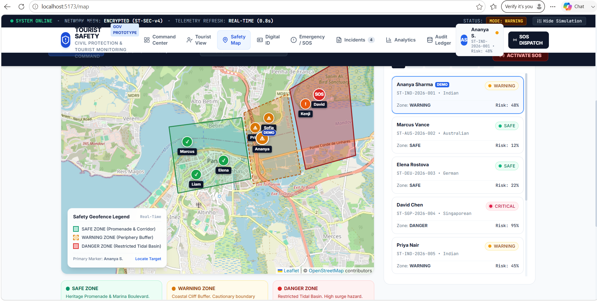
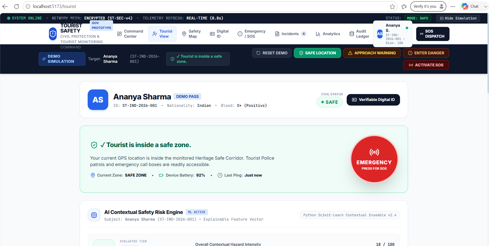

### AI Risk Engine · Geo-Fencing · Blockchain-style Digital ID

*A proactive, context-aware tourist protection ecosystem.*

 

---

## 📌 Overview

Tourist safety is often **reactive**: help is requested only after something has already gone wrong. **Smart Tourist Safety** shifts that model to **proactive, context-aware protection**.

The platform tracks tourist location in real time, checks it against predefined geographic risk zones, scores the contextual risk of the situation with an explainable ML model, and automatically raises incidents with dispatch to a command center. Every identity check and incident is written to a tamper-evident, hash-chained audit ledger.

> **Core question:** *How can we detect risk early, identify the tourist reliably, and enable faster incident response?*

---

## 🚨 The Problem

| | Challenge | Description |
|---|---|---|
| 01 | **Unseen hazards** | Tourists may unknowingly enter dangerous, restricted or remote areas without awareness of geographic risks. |
| 02 | **Delayed detection** | Traditional monitoring identifies problems only after a distress event or crime has occurred. |
| 03 | **Limited response context** | Responders lack precise real-time GPS location and situational context during an active incident. |
| 04 | **Identity & record challenge** | Verifying identity quickly and keeping tamper-proof incident records is hard under pressure. |

---

## 💡 Our Solution

An end-to-end automated safety workflow built on four pillars:

| Pillar | What it does |
|---|---|
| 🧠 **AI Risk Engine** | Contextual risk assessment from telemetry, movement and environment. |
| 🗺️ **Geo-Fencing** | Real-time polygon tracking and immediate detection of geographic risk. |
| 🪪 **Digital ID** | Cryptographic identity verification for trusted tourist records. |
| 🚑 **Incident Response** | Automated real-time dispatch and command-center escalation. |

---

## ✨ Key Features

- **Explainable risk scoring**: clear contributing factors, not a black-box number.
- **Real-time response**: location, SOS and dispatch synchronised instantly over WebSockets.
- **Verified Digital ID**: cryptographic verification helps prevent spoofing during emergencies.
- **Tamper-evident audit ledger**: SHA-256 chained records so events cannot be silently altered.
- **Live GIS map**: tourists, zones and incidents on a Leaflet map with a safety legend.
- **Command Center console**: risk-prioritised alerts, tourist background data and incident tracking.
- **Resilient by design**: a JavaScript risk fallback if the AI microservice is unavailable.

---

## 🏗️ System Architecture

```mermaid
flowchart LR
    subgraph FE["Frontend Layer"]
        A1[React / Vite UI]
        A2[Digital ID Module]
        A3[Live Leaflet GIS Map]
        A4[AI Risk Explainer Card]
        A5[Tamper-Evident Ledger UI]
        A6[Command Center Console]
    end

    subgraph BE["Backend & Dispatch"]
        B1[Node.js + Express]
        B2[GeoFence Engine]
        B3[Dispatch Manager]
        B4[Socket.IO Telemetry]
        B5[Hash Verifier]
        B6[Chained Ledger Service]
    end

    subgraph AI["AI Microservice"]
        C1[Python Flask]
        C2[7-D Vector Extractor]
        C3[Scikit-learn Ensemble]
        C4[Factor Decomposition]
        C5[Tactical Advisory Engine]
        C6[JS Risk Fallback]
    end

    subgraph DATA["Ledger & Data"]
        D1[SHA-256 Chained Hash]
        D2[Tamper Audit Records]
        D3[GeoJSON Danger Polygons]
        D4[Identity Verification Store]
    end

    FE <-->|REST + WebSocket| BE
    BE <-->|REST| AI
    BE <--> DATA
```

| Layer | Components |
|---|---|
| **Frontend** | React / Vite, Digital ID module, SHA-256 check, AI Risk Explainer card, tamper-evident ledger UI, live Leaflet GIS map, command center console |
| **Backend & Dispatch** | Node.js + Express, hash verifier, REST APIs, GeoFence engine, dispatch manager, Socket.IO telemetry, chained ledger service |
| **AI Microservice** | Python Flask, 7-D vector extractor, Scikit-learn ensemble, factor decomposition, tactical advisory engine, JS risk fallback |
| **Ledger & Data** | SHA-256 chained hash, tamper audit records, GeoJSON danger polygons, identity verification store |

---

## ⚙️ How It Works

The system is built from three cooperating engines.

### 1. Geo-Fencing Engine
Evaluates GPS coordinates against predefined zones using a **ray-casting point-in-polygon** algorithm.

| Zone | Meaning |
|---|---|
| 🟢 **Safe** | Monitored, patrolled areas (e.g. promenade and heritage corridor) |
| 🟡 **Warning** | Buffer or periphery areas that call for caution |
| 🔴 **Danger** | Restricted or high-hazard areas |

`GPS → Polygon Check → Breach Event`

### 2. AI Risk Engine
Scores the **contextual risk of the situation**. It does **not** predict crimes. Each tourist is described by a 7-dimensional feature vector:

| # | Feature |
|---|---|
| 1 | Location Risk |
| 2 | Zone Risk |
| 3 | Anomaly |
| 4 | Time Risk |
| 5 | Events |
| 6 | Safe Haven |
| 7 | SOS Signal |

`Telemetry → Vector → Scikit-learn → Risk Score`

The score is decomposed into contributing factors so authorities can see *why* a tourist is flagged.

### 3. Incident Response
Automatically creates actionable incidents and dispatches them to emergency authorities. A tamper-evident chained audit ledger logs every event permanently.

`Risk Detected → Incident → Dispatch → Audit`

> **One event → Detection → Assessment → Alert → Response → Audit**

---

## 🖼️ Demo

**Example scenario:** a tourist enters a monitored high-risk zone. The prototype includes a demo simulation with *Safe Location*, *Approach Warning*, *Enter Danger* and *Activate SOS* controls.

<table>
  <tr>
    <td align="center" width="50%">
       
      <b>Tourist View</b>: Digital ID, zone status, SOS and AI risk engine
    </td>
    <td align="center" width="50%">
       
      <b>Safety Map</b>: live geo-fence zones and risk-ranked tourists
    </td>
  </tr>
</table>

---

## 🛠️ Technology Stack

| Area | Technologies |
|---|---|
| **Frontend** | React, Vite, JavaScript / TypeScript, Leaflet GIS map |
| **Backend** | Node.js, Express.js, RESTful APIs, Socket.IO |
| **AI / ML Engine** | Python, Flask API, Scikit-learn, NumPy |
| **Security & Trust** | SHA-256, hash verifier, chained ledger, audit log |
| **Real-time system** | WebSocket, Socket.IO, telemetry sync, live alerts |

---

## 🌍 Innovation & Impact

| Innovation | Value |
|---|---|
| **AI + Geo-Fencing** | Combines boundary spatial analysis with multi-factor risk scoring |
| **Explainable Risk** | Shows contributing factors instead of a black-box number |
| **Real-time Response** | Location, SOS and dispatch synchronised instantly |
| **Verified Digital ID** | Prevents spoofing during emergencies |
| **Tamper Audit** | Chained cryptographic ledger keeps records unalterable |

| Who | Benefits |
|---|---|
| 🧳 **Tourists** | Early safety advisories, instant SOS dispatch, verified Digital ID |
| 🏛️ **Authorities** | Real-time visual map, risk-prioritised alerts, transparent auditability |
| 🚓 **Responders** | Exact location context, tourist background data, actionable advisories |
| 🌐 **Ecosystem** | Enhanced safety reputation, automated tracking, scalable infrastructure |

---

## 🎯 Conclusion

**Smarter tourism. Safer journeys.**

- **Proactive monitoring**: real-time GPS and geo-fencing flag unsafe situations before they escalate.
- **Intelligent assessment**: AI evaluates 7 contextual feature dimensions to produce actionable risk scores.
- **Faster response**: automated incident creation and dispatch give authorities crucial context.
- **Trusted records**: cryptographic Digital IDs and chained audit ledgers guarantee identity and event integrity.

> *From knowing **where** the tourist is, to understanding **how risky** the situation is, to enabling **what action** should happen next.*

---

